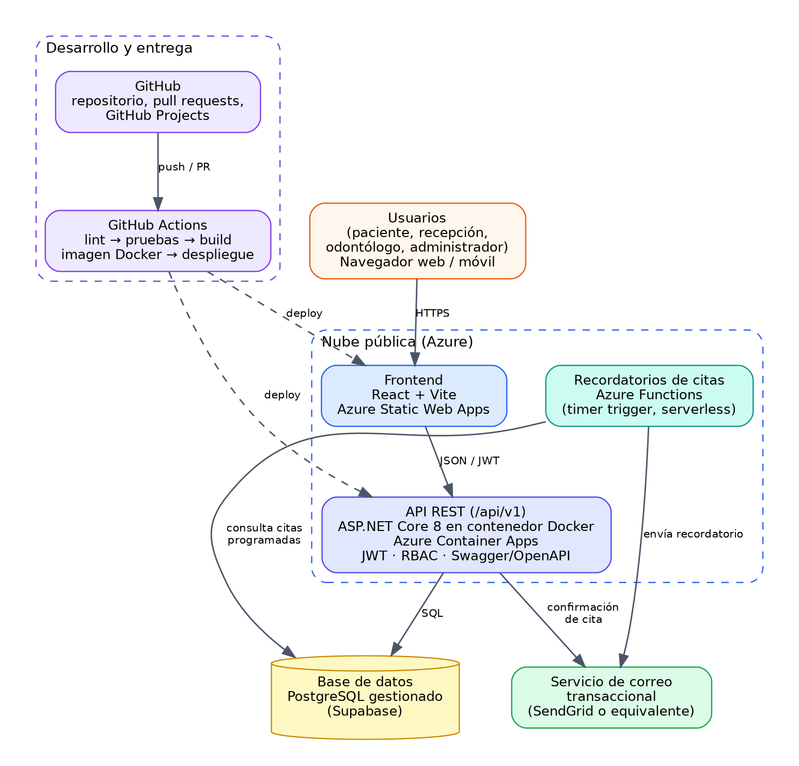

# Sistema web para consultorios dentales — Base de datos

Aplicación web para gestionar pacientes, odontólogos, servicios, citas, expediente clínico, notificaciones y reportes de una clínica dental.

**Curso:** Desarrollo de Aplicaciones para la Computación en la Nube (16-0550), ULACIT, III Cuatrimestre 2026  
**Profesora:** Karol Leal  
**Estado:** en desarrollo.  
**Aplicación desplegada:** _pendiente_

## Qué es este repositorio

Este repositorio es la **base de datos** del sistema. Contiene:

- Las migraciones SQL: cada cambio en la estructura es un archivo versionado.
- Los datos ficticios de desarrollo (`supabase/seed.sql`).
- Las pruebas pgTAP que verifican las reglas de negocio dentro de la base.
- El pipeline que aplica los cambios a los proyectos de Supabase.

El API y el frontend viven en sus propios repositorios:

- API: https://github.com/Diegoalru/clinica-dental-api-cloud
- Frontend: https://github.com/Diegoalru/clinica-dental-web-cloud

## Stack tecnológico

| Capa | Tecnología |
|---|---|
| Base de datos | PostgreSQL administrado en Supabase |
| Herramientas de BD | Supabase CLI, pgTAP, GitHub Actions |
| API | ASP.NET Core 10 Web API, Entity Framework Core + Npgsql, JWT, Swagger/OpenAPI |
| Frontend | React con Vite, React Router, Axios, Tailwind CSS |

## Equipo

| Integrante | Rol principal |
|---|---|
| [Integrante 1] | Coordinación y producto |
| [Integrante 2] | Backend y seguridad |
| [Integrante 3] | Frontend y experiencia |
| [Integrante 4] | Datos y calidad |
| [Integrante 5] | [Rol] |

## Arquitectura



La API es un backend modular y sin estado; los recordatorios de citas los envía una función programada.

## Estructura del repositorio

```
supabase/
├── config.toml          configuración de Supabase CLI
├── migrations/          migraciones SQL, una por cambio de estructura
├── seed.sql             datos ficticios de desarrollo
└── tests/
    └── database/        pruebas pgTAP (*.test.sql)
docs/                    DER, diagramas de flujo y arquitectura
```

## Levantar la base de datos local

Requisitos en Windows:

1. **Docker Desktop**, abierto y en ejecución. Supabase local corre en contenedores.
2. **Supabase CLI**, instalada con Scoop:

   ```powershell
   scoop bucket add supabase https://github.com/supabase/scoop-bucket.git
   scoop install supabase
   ```

3. Clonar el repositorio:

   ```powershell
   git clone https://github.com/durena-dev/clinica-dental-cloud.git
   cd clinica-dental-cloud
   ```

Comandos principales (PowerShell, desde la carpeta del repositorio):

```powershell
supabase start      # levanta el stack local (la primera vez descarga imágenes y tarda)
supabase db reset   # borra la BD local, aplica todas las migraciones y el seed
supabase test db    # corre las pruebas pgTAP
supabase stop       # apaga los contenedores al terminar
```

`supabase status` muestra las URLs locales (incluida la de Studio, el panel para ver tablas y datos) y las credenciales de la base local.

## Credenciales de prueba

Las cuentas están en `supabase/seed.sql` y se crean al ejecutar `supabase db reset`. **Son datos ficticios de demostración**, no son credenciales reales.

Contraseña de todas las cuentas: `Clinica2026!`

La base de la demo en Supabase se cargó con este mismo `supabase/seed.sql`, así que estas cuentas funcionan allí con la misma contraseña, igual que en la base local.

| Rol | Correo |
|---|---|
| ADMIN | admin@clinica.example |
| RECEPTIONIST | recepcion@clinica.example |
| DENTIST | ana.mora@clinica.example |
| DENTIST | luis.rojas@clinica.example |
| DENTIST | marta.vega@clinica.example |
| PATIENT | sofia.castro@clinica.example |
| PATIENT | mateo.jimenez@clinica.example |

## Base de datos en la nube

La base de datos de la demo está en Supabase, en el proyecto `clinica-dental` (región East US). El esquema se aplicó con la CLI a partir de las migraciones de este repositorio, así que la nube tiene la misma estructura y los mismos datos de prueba que la base local. Las credenciales y la cadena de conexión no se publican en el repositorio.

Próximamente: un proyecto de staging y el despliegue automático de migraciones con GitHub Actions.

## Flujo de trabajo

Ver [CONTRIBUTING.md](CONTRIBUTING.md): ramas cortas, Conventional Commits y pull requests con revisión de otro integrante.

Los cambios de estructura se hacen siempre con una migración nueva (`supabase migration new <nombre>`). Nunca se edita una migración que ya está en `main`.

## Documentación

- [Diagrama entidad-relación](docs/DER.png) (fuente editable: [der.dbml](docs/der.dbml), se abre en dbdiagram.io)
- [Flujo de agendamiento](docs/flujo-agendamiento.png)
- [Flujo de atención y expediente](docs/flujo-atencion.png)
- [Arquitectura](docs/arquitectura.png)
