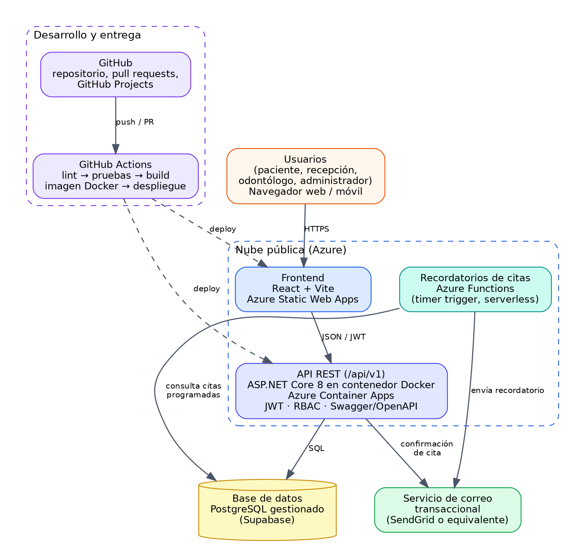

# Sistema web para consultorios dentales

Aplicación web para gestionar pacientes, odontólogos, servicios, citas, expediente clínico, notificaciones y reportes de una clínica dental.

**Curso:** Desarrollo de Aplicaciones para la Computación en la Nube (16-0550), ULACIT, III Cuatrimestre 2026  
**Profesora:** Karol Leal  
**Estado:** Avance 1 (propuesta y diseño). El código del backend y del frontend se agrega a partir del Avance 2.  
**Aplicación desplegada:** _pendiente_

<!-- Badge de CI/CD (se agrega cuando exista el workflow):
 -->

## Equipo

| Integrante | Rol principal |
|---|---|
| [Integrante 1] | Coordinación y producto |
| [Integrante 2] | Backend y seguridad |
| [Integrante 3] | Frontend y experiencia |
| [Integrante 4] | Datos y calidad |
| [Integrante 5] | [Rol] |

## Stack tecnológico

Las versiones exactas se confirman al crear los proyectos.

| Capa | Tecnología |
|---|---|
| Frontend | React con Vite, React Router, Axios, Tailwind CSS |
| Backend | ASP.NET Core 8 Web API, Entity Framework Core, JWT, Swagger/OpenAPI |
| Base de datos | PostgreSQL gestionado en Supabase |
| Contenedores | Docker y Docker Compose |
| Nube | Azure for Students: Static Web Apps, Container Apps y Functions |
| CI/CD y calidad | GitHub Actions, ESLint, xUnit, Conventional Commits |

## Arquitectura



La API es un backend modular y sin estado; los recordatorios de citas los envía una función programada. Las decisiones de diseño están en `docs/Avance1_Propuesta.pdf`.

## Estructura del repositorio

```
backend/     API REST (ASP.NET Core)
frontend/    Aplicación web (React + Vite)
database/    schema.sql (esquema PostgreSQL) y seed.sql (datos ficticios)
docs/        DER, diagramas de flujo, arquitectura y documento de propuesta
.github/     Plantilla de pull request y workflows de CI/CD
```

## Instalación local

> Disponible a partir del Avance 2.

```bash
# Clonar el repositorio
git clone <url-del-repositorio>
cd clinica-dental-cloud

# Variables de entorno necesarias
cp .env.example .env

# Construcción y ejecución con Docker
docker-compose up --build
```

## Variables de entorno

Están descritas en [`.env.example`](.env.example). El archivo `.env` real nunca se sube al repositorio.

## Base de datos

El esquema está en [`database/schema.sql`](database/schema.sql) y los datos ficticios de prueba en [`database/seed.sql`](database/seed.sql). Requiere PostgreSQL 15 o superior (usa la extensión `btree_gist`).

```bash
psql "$DATABASE_URL" -f database/schema.sql
psql "$DATABASE_URL" -f database/seed.sql
```

## Despliegue

_Se documenta en el Avance 2: pasos para replicar el despliegue en Azure y configuración de Supabase._

## Credenciales de prueba

_Se definen junto con los usuarios de demostración._

| Rol | Correo | Contraseña |
|---|---|---|
| Administrador | _pendiente_ | _pendiente_ |
| Usuario estándar | _pendiente_ | _pendiente_ |

## Flujo de trabajo

Ver [CONTRIBUTING.md](CONTRIBUTING.md): ramas cortas, Conventional Commits y pull requests con revisión de otro integrante.

## Documentación

- [Propuesta del Avance 1](docs/Avance1_Propuesta.pdf)
- [Diagrama entidad-relación](docs/DER.png) (fuente editable: [der.dbml](docs/der.dbml), se abre en dbdiagram.io)
- [Flujo de agendamiento](docs/flujo-agendamiento.png)
- [Flujo de atención y expediente](docs/flujo-atencion.png)
